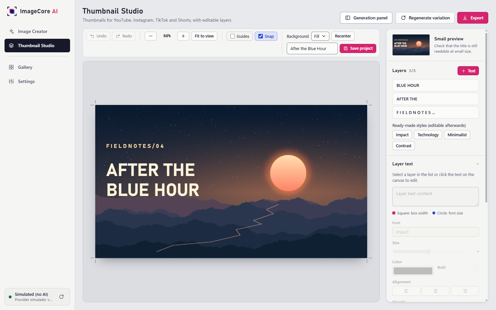

# ImageCore AI

**A local studio for AI images and editable thumbnails.**

[](#installation)
[](#installation)
[](LICENSE)



*The Mesa de Prova interface showing an editable thumbnail with demonstration artwork.*

## Overview

Generate an image from a prompt or reference, bring it into Thumbnail Studio, and finish the composition with editable text. ImageCore AI keeps images, exports, settings, and saved projects on your machine. It connects to a local ComfyUI instance for inference.

## Features

- **AI Image Creator** supports text-to-image and single-reference image-to-image. Set the aspect ratio, target dimensions, style, seed, and generation parameters.
- **Thumbnail Studio** includes social platform presets and a canvas for stacking, moving, resizing, and styling text layers. Save editable projects and reopen them from the Gallery.
- **Image Gallery** organizes generations, editable projects, and exports. Search and filter generations, reopen a result, or select visible generations and generation exports for bulk deletion. Saved projects keep their own background copies.
- **PNG and JPEG export** supports custom dimensions and JPEG quality. With SDXL, export resizing is separate from the model's native generation size.
- **Local persistence** uses SQLite and files on disk. The interface and settings are available in English (US) and Brazilian Portuguese.

## Installation

Use **Python 3.12 or later**, PowerShell, and a current browser on Windows. Real image generation also requires a separate ComfyUI installation, a supported checkpoint, and hardware that can run it.

From the project root:

```powershell
python -m venv .venv
.\.venv\Scripts\python.exe -m pip install -e .
```

## Quick start

### Try the studio

Start the local server and open [ImageCore AI on port 8765](http://127.0.0.1:8765/).

```powershell
$env:IMAGECORE_PROVIDER = 'simulated'
.\.venv\Scripts\python.exe -m backend.main
```

The simulated provider creates labeled placeholders without a GPU. You can try the Gallery, upload your own background, and use the editor and export tools.

### Connect ComfyUI

1. Install and start [ComfyUI](https://docs.comfy.org/installation/manual_install) separately. Its default local endpoint is `http://127.0.0.1:8188`.
2. Install the [SDXL Base 1.0 checkpoint](https://huggingface.co/stabilityai/stable-diffusion-xl-base-1.0) as `models/checkpoints/sd_xl_base_1.0.safetensors` in your ComfyUI installation.
3. If you already ran the simulated server, stop it with **Ctrl+C** before switching providers. Create your local settings from the example:

   ```powershell
   Copy-Item config/settings.example.yaml config/settings.yaml
   Remove-Item Env:IMAGECORE_PROVIDER -ErrorAction SilentlyContinue
   ```

4. Open `config/settings.yaml` and set `comfyui.models_dir` to the ComfyUI `models` directory. Confirm the endpoint and keep the included SDXL workflow paths.
5. Run `.\.venv\Scripts\python.exe -m backend.main` and check the engine and SDXL profile in **Settings**.

The direct launch listens on loopback. The optional `start.bat` launcher can start a Windows NVIDIA Portable installation and enables LAN access by default. To use the launcher, supply the installation folder in `COMFY_DIR` or on the first line of `config/comfy.local.txt`. Set `ENABLE_LAN=0` in the batch file to keep it on loopback.

## Model support

| Profile | Status in ImageCore AI |
| --- | --- |
| **SDXL Base 1.0** | Validated with ComfyUI for text-to-image and single-reference image-to-image. The included settings use its workflows by default. |
| **FLUX.2 Klein 4B** | Candidate text-to-image workflow. Requires compatible weights, local configuration, and a real generation test. |
| **Z-Image-Turbo int8** | Candidate text-to-image workflow. Requires compatible weights, local configuration, and a real generation test. |

The Settings page reports profile availability based on the configured workflow and local weights. It tracks available files and validated execution separately.

## Project structure

| Path | Contents |
| --- | --- |
| `backend/` | FastAPI routes, generation jobs, providers, and SQLite storage |
| `frontend/` | HTML, CSS, JavaScript, and the two locale dictionaries |
| `config/` | Example settings and ComfyUI workflow JSON |
| `data/` | Local generations, projects, references, and database |
| `docs/` | Project documentation and the screenshot |
| `tests/` | Python and JavaScript checks |

Read the [architecture notes](docs/architecture.md) and [Mesa de Prova design specification](DESIGN.md) for details.

## Development

```powershell
.\.venv\Scripts\python.exe -m pip install -e ".[dev]"
.\.venv\Scripts\python.exe -m pytest
node --test tests/js/*.test.mjs
node tests/js/gitignore_check.mjs
```

The JavaScript checks require Node.js. Python integration tests use the simulated provider and temporary local storage.

## License

ImageCore AI is available under the [MIT License](LICENSE). ComfyUI, model weights, and adapted workflow templates have their own terms. See [Third-party notices](THIRD_PARTY_NOTICES.md).
